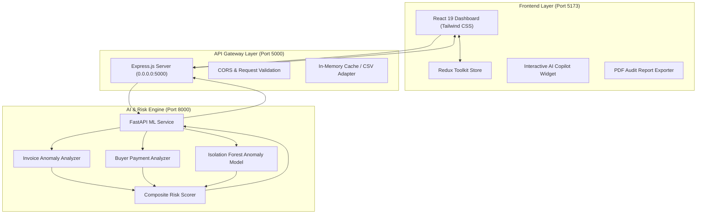

# 🛡️ InvoiceGuard AI
**Autonomous Multi-Agent Risk Assessment & Underwriting Radar for Supply Chain Finance**

[](https://react.dev/)
[](https://fastapi.tiangolo.com/)
[](https://nodejs.org/)
[](https://scikit-learn.org/)
[](LICENSE)

---

## 📌 Table of Contents
- [📖 Project Introduction](#-project-introduction)
- [⚠️ Problem Statement](#️-problem-statement)
- [💡 Proposed Solution](#-proposed-solution)
- [🌟 Project Novelty](#-project-novelty)
- [✨ Key Features](#-key-features)
- [🏗️ System Architecture](#️-system-architecture)
- [💻 Technology Stack](#-technology-stack)
  - [Frontend](#frontend)
  - [Backend & API Gateway](#backend--api-gateway)
  - [AI / Machine Learning Engine](#ai--machine-learning-engine)
- [🧠 AI/ML & Risk Analysis Components](#-aiml--risk-analysis-components)
- [⚙️ Installation Instructions](#️-installation-instructions)
- [🚀 Execution Instructions](#-execution-instructions)
- [📸 Screenshots & UI Showcase](#-screenshots--ui-showcase)
- [👥 Team Contributions](#-team-contributions)
- [🔮 Future Enhancements](#-future-enhancements)
- [📄 License](#-license)

---

## 📖 Project Introduction

**InvoiceGuard AI** is a next-generation decision-support system and autonomous underwriting radar built for supply chain financiers, factoring firms, and corporate treasury teams. It replaces slow, error-prone manual invoice verification and backward-looking credit scores with real-time multi-agent intelligence and machine learning anomaly detection.

By analyzing both the individual transaction characteristics (amount, duplicate flags, timeline) and the historical behavioral patterns of the counterparty buyer, InvoiceGuard provides underwriters with instantaneous, explainable risk assessments before financing capital is deployed.

---

## ⚠️ Problem Statement

Invoice factoring and supply chain discounting form the lifeblood of Micro, Small, and Medium Enterprises (MSMEs). However, the traditional underwriting process suffers from critical systemic vulnerabilities:

1. **Slow Approval Cycles**: Manual verification of invoices, purchase orders, and counterparty records takes days or weeks, starving suppliers of working capital.
2. **Fraud & Duplicate Financing**: Illicit actors submit duplicate invoices across multiple financiers or alter invoice figures to extract unbacked liquidity.
3. **Static, Lagging Credit Scores**: Traditional bureau scores evaluate past defaults over multi-year horizons, completely missing rapid operational deteriorations or sudden liquidity crunches.
4. **Cascading Supply Chain Contagion**: When a corporate Anchor Buyer delays payment, the liquidity shock cascades downward, triggering insolvencies across tier-2 and tier-3 MSME suppliers.

---

## 💡 Proposed Solution

InvoiceGuard AI shifts the underwriting paradigm from **reactive post-mortems** to **predictive, real-time risk radar**:

* **Multi-Stage Automated Verification**: Ingests invoice payloads and runs automated checks across invoice consistency, counterparty payment history, and ML anomaly models in milliseconds.
* **Granular White-Box Risk Scoring**: Computes a transparent $0 - 100$ risk score backed by clear mathematical factors rather than opaque black-box recommendations.
* **Human-in-the-Loop Decisioning**: Clear actionable routing categories (`APPROVE`, `REVIEW`, `ESCALATE`) designed to accelerate low-risk invoices directly while queuing edge-cases for senior underwriter evaluation.
* **Auto-Generated Supplier Communications**: Context-aware communication templates generated instantly to clarify flagged discrepancies without delays.

---

## 🌟 Project Novelty

| Dimension | Traditional Factoring | InvoiceGuard AI Approach |
| :--- | :--- | :--- |
| **Data Horizon** | Multi-year historical bureau reports | Transaction-level real-time counterparty telemetry |
| **Fraud Detection** | Manual spot-checks & spreadsheet formulas | Scikit-Learn Isolation Forest & exact duplicate hash matching |
| **Explainability** | Generic risk grade (e.g., "BB+") | SHAP-inspired explainability with factor-by-factor attribution |
| **Response Speed** | 3 to 7 business days | Sub-second ($< 250\text{ms}$) real-time analysis |
| **Workflow Support** | Disconnected emails and PDF forms | Unified interactive dashboard with one-click audit PDF exports |

---

## ✨ Key Features

- ⚡ **Real-Time Risk Scoring**: Sub-second risk scoring aggregating invoice variance, payment delays, and ML outlier detection.
- 🔍 **Multi-Agent Simulation**: Structured agents analyzing extraction, counterparty KYC, anomaly detection, and routing policy.
- 📊 **Interactive Risk Visualizations**: Chart.js-powered distribution charts and trust metrics for corporate anchor buyers.
- 📑 **Instant Audit PDF Generation**: Native, high-resolution PDF risk report export powered by `html2canvas` and `jspdf` for compliance archiving.
- 💬 **Interactive AI Underwriter Copilot**: Floating conversational assistant guiding underwriters through flagged anomalies and policy guidelines.
- 🛡️ **Duplicate Invoice Shield**: Immediate detection of resubmitted invoice IDs or matching transaction amounts across identical counterparties.
- 🎨 **Modern Neo-Bank UI**: Designed with clean contrast, responsive cards, toast feedback, and accessible layout ergonomics.

---

## 🏗️ System Architecture



---

## 💻 Technology Stack

### Frontend
- **Framework**: [React 19](https://react.dev/)
- **Build Tool**: [Vite 8](https://vite.dev/)
- **State Management**: [Redux Toolkit](https://redux-toolkit.js.org/)
- **Styling**: [Tailwind CSS v4](https://tailwindcss.com/)
- **Data Visualization**: [Chart.js](https://www.chartjs.org/) & [react-chartjs-2](https://react-chartjs-2.js.org/)
- **Icons**: [Lucide React](https://lucide.dev/)
- **PDF Export**: [html2canvas](https://html2canvas.hertzen.com/) & [jspdf](https://github.com/parallax/jsPDF)
- **HTTP Client**: [Axios](https://axios-http.com/)

### Backend & API Gateway
- **Runtime**: [Node.js](https://nodejs.org/)
- **Web Framework**: [Express.js](https://expressjs.com/)
- **Middleware**: CORS, Express JSON Parser
- **Remote Access / Demo**: [Localtunnel](https://localtunnel.me/)
- **Schema Reference**: PostgreSQL enterprise schema (`backend/schema.sql`)

### AI / Machine Learning Engine
- **Framework**: [FastAPI](https://fastapi.tiangolo.com/) (Python 3.10+)
- **Server**: [Uvicorn](https://www.uvicorn.org/)
- **Machine Learning**: [Scikit-Learn](https://scikit-learn.org/) (`IsolationForest`)
- **Data Manipulation**: [Pandas](https://pandas.pydata.org/) & [NumPy](https://numpy.org/)
- **Validation**: [Pydantic](https://docs.pydantic.dev/)

---

## 🧠 AI/ML & Risk Analysis Components

The risk evaluation uses a 3-pillar composite architecture:

```
+-----------------------------------------------------------------------+
|                       OVERALL RISK SCORE (0 - 100)                    |
+-----------------------------------------------------------------------+
|  Invoice Risk (35%)   |  Payment History (35%)  |  ML Anomaly (30%)   |
+-----------------------------------------------------------------------+
```

### 1. Invoice Anomaly Risk ($0 - 100$)
* Evaluates current invoice amount relative to the buyer's historical baseline:
  $$\text{Amount Ratio} = \frac{\text{Invoice Amount}}{\text{Buyer Average Amount}}$$
* Identifies duplicate submissions and date irregularities.

### 2. Counterparty Payment Behavior Risk ($0 - 100$)
* Analyzes payment delinquency frequency and delay severity:
  $$\text{Delay Ratio} = \frac{\text{Previous Delayed Invoices}}{\text{Total Historical Invoices}}$$
* Integrates average historical delay days to compute counterparty liquidity strain.

### 3. Machine Learning Isolation Forest ($0 - 100$)
* Trained on multivariate feature spaces $(\text{Amount}, \text{Average Delay})$.
* Measures mathematical outlier isolation depth using Scikit-Learn's `IsolationForest`.
* Provides white-box factor attributions (e.g., *"Invoice is 3.8x higher than anchor buyer standard deviation"*).

### Risk Classification & Routing Guardrails
* **$0 - 30$ $\rightarrow$ LOW RISK (`APPROVE`)**: Auto-cleared for immediate disbursement.
* **$31 - 60$ $\rightarrow$ MEDIUM RISK (`REVIEW`)**: Human underwriter verification required.
* **$61 - 100$ $\rightarrow$ HIGH RISK (`ESCALATE`)**: Flagged for senior committee review; auto-drafts inquiry to supplier.

---

## ⚙️ Installation Instructions

### Prerequisites
- **Node.js** (v18.x or higher) & **npm**
- **Python** (v3.10 or higher) & **pip**
- **Git**

### Clone Repository
```bash
git clone https://github.com/DhushyanthB05/Invoice_Guard-.git
cd Invoice_Guard-
```

### 1. Set Up the Python ML Engine
```bash
cd ml-risk-engine
python -m venv venv

# On Windows:
.\venv\Scripts\activate

# On macOS/Linux:
source venv/bin/activate

pip install -r requirements.txt
cd ..
```

### 2. Set Up the Backend Gateway
```bash
cd backend
npm install
cd ..
```

### 3. Set Up the React Frontend
```bash
cd frontend
npm install
cd ..
```

---

## 🚀 Execution Instructions

Run each component in a separate terminal:

### Terminal 1: Python ML Engine (Port 8000)
```bash
cd ml-risk-engine
# Windows shortcut:
.\start_ml.bat

# Or manual execution:
python -m uvicorn src.api.main:app --reload --port 8000
```
*Health Check: `http://localhost:8000/docs`*

### Terminal 2: Node.js Backend Gateway (Port 5000)
```bash
cd backend
npm start
```
*Health Check: `http://localhost:5000/api/health`*

### Terminal 3: React Frontend (Port 5173)
```bash
cd frontend
npm run dev
```
*Access Application: `http://localhost:5173`*

---

## 📸 Screenshots & UI Showcase

| Dashboard & Smart Underwriting Queue | Risk Score Radar & Explainability |
| :---: | :---: |
|  |  |
| *Batch assessment of incoming MSME factoring requests* | *Transparent factor attribution with recommendation action* |

*(Place updated application screenshots in `docs/screenshots/` for visual documentation).*

---

## 👥 Team Contributions

* **Dhushyanth B** — *Full-Stack Architecture, ML Risk Engine, React Dashboard & Redux Integration*
* **Project Team & Collaborators** — *Data Modeling, Synthetic Dataset Generation & Underwriting Logic Validation*

---

## 🔮 Future Enhancements

- [ ] **Direct ERP Integrations**: Two-way connectors for SAP S/4HANA, TallyPrime, and QuickBooks.
- [ ] **GSTN / Tax Portal Verification**: Real-time e-Way bill and GST compliance cross-referencing via government APIs.
- [ ] **Smart Contract Escrow**: Automated settlement and milestone payouts via decentralized smart contracts.
- [ ] **Advanced Graph Neural Networks (GNN)**: Identifying circular trading fraud across complex supplier-buyer clusters.

---

## 📄 License

This project is licensed under the MIT License — see the [LICENSE](LICENSE) file for details.
